# 🎯 Dogfood 2026 — Defensible Hackathon Platform

     -10B981?style=flat)  

> **"A hackathon can collect hundreds of submissions and dozens of judge scores. The hard part is making the final result trustworthy."**

An auditable, offline-first hackathon lifecycle platform written in modern Go and self-contained SQLite. Implements end-to-end team collaboration, submission management, deterministic bipartite judge allocation, versioned weighted scoring rubrics, statistical score normalization (mitigating scale disparities across harsh and lenient reviewers), cryptographic replay verification, and real-time organizer operations.

**Dogfood 2026 Hackathon Platform**  
**Team:** Hackathon Raptors  
**Validation Status:** **7 / 7 Official Acceptance Tests Passed (100.0%) · 8 / 8 Go Packages PASS · 100% Bit-for-Bit Replay Parity**

---

## 📌 Table of Contents

- [Tier Implementation & Screen Map](#-tier-implementation--screen-map)
- [Architecture & Transaction Boundaries](#-architecture--transaction-boundaries)
- [Key System Guarantees & Empirical Parity](#-key-system-guarantees--empirical-parity)
- [Application Screen Showcase](#-application-screen-showcase)
- [Statistical & Normalization Mathematics](#-statistical--normalization-mathematics)
- [Tech Stack](#-tech-stack)
- [Quick Start](#-quick-start)
- [Cryptographic Replay Verification Engine](#-cryptographic-replay-verification-engine)
- [Pre-Seeded Demo Personas](#-pre-seeded-demo-personas)
- [Programmatic REST API](#-programmatic-rest-api)
- [Repository Structure](#-repository-structure)
- [Threat Model & Security Invariants](#-threat-model--security-invariants)
- [Authors & Team](#-authors--team)

---

## 🏛️ Tier Implementation & Screen Map

The application interface and backend subsystems strictly reflect all evaluation checkpoints and operational tiers:

| Tier | Subsystem | Screen Name / Route | Core Deliverables & Evidentiary Proof | Status |
|---|---|---|---|---|
| **Tier 1** | **Core Portal & Teams** | `/projects`, `/projects/new` | Public project gallery with interactive grid; team formation & invite tokens; single-team exclusivity (max 4 members); lifecycle window enforcement; track/prize configuration. | **100% PASS** |
| **Tier 1** | **Identity & Zero-Trust Auth** | `/login` | 5 pre-seeded role personas (Organizer, Judges, Participants); session cookie authentication; direct bearer tokens; automatic session revocation; zero external OAuth/network calls. | **100% PASS** |
| **Tier 2** | **Deterministic Allocation** | `/dashboard#judges` | Constrained bipartite matching engine; strict track eligibility enforcement; reviewer capacity bounds; deterministic lexicographical sort; zero duplicate or self-assignments. | **100% PASS** |
| **Tier 2** | **Judge Workspace & Ballots** | `/dashboard`, `/evaluations/{id}` | Strict judge peer isolation (`403 Forbidden`); immutable versioned rubrics; draft-to-final lifecycle; permanent lock on submission (`409 Conflict` on tamper attempts). | **100% PASS** |
| **Tier 2** | **Defensible Normalization** | `/results` | Z-score standardization with Bessel's correction; linear rescaling to $[0.0, 5.0]$; explicit documented fallbacks (`ZERO_VARIANCE`, `LOW_N`); deterministic 4-tier tie-breaking. | **100% PASS** |
| **Tier 2** | **Audit Receipts & Replay** | `/results/{run}/explain/{proj}` | Transparent "Explain This Rank" mathematical derivation receipts; independent CLI replay command (`dogfood replay`) reproducing published standings with 100% mathematical equality. | **100% PASS** |
| **Tier 2** | **Organizer Control Room** | `/dashboard#judging-progress` | Real-time review velocity tracking; judge roster administration; project review coverage indicators; RFC 4180 CSV exports with Spreadsheet Formula Injection Defense (F21). | **100% PASS** |
| **Tier 3** | **Community Engagement** | `/projects/{id}` | Duplicate-protected community voting; hidden results policy during active voting; threaded project discussions; full community vote audit ledger. | **100% PASS** |
| **Tier 4** | **Platform Extensions** | `/projects/{id}/certificate` | Verifiable completion certificates with SHA-256 submission integrity seal; embeddable HTML cards; event webhook engine; RFC-compliant bulk JSON export. | **100% PASS** |

---

## 🏗️ Architecture & Transaction Boundaries

Dogfood is architected around **strict isolation boundaries, append-only immutable ledgers, and deterministic reproducibility**:

```
┌────────────────────────────────────────────────────────────────────────┐
│                        HTTP & INGRESS LAYER                            │
│     Go Standard Library Mux · Pure System Font Stack · Zero CDN        │
│   Session Auth (Cookie / Bearer) · RBAC Middleware · F21 CSV Shield    │
└───────────────────────────────────┬────────────────────────────────────┘
                                    │
            ┌───────────────────────┼───────────────────────┐
            ▼                       ▼                       ▼
    ┌──────────────┐        ┌──────────────┐        ┌──────────────┐
    │  PARTICIPANT │        │    JUDGE     │        │  ORGANIZER   │
    │  Team Tokens │        │ Peer-Isolated│        │ Control Room │
    │  Draft Spec  │        │ Strict Rubric│        │ Alloc. Graph │
    │  Submissions │        │ Ballot Seals │        │ Velocity Ops │
    └──────┬───────┘        └──────┬───────┘        └──────┬───────┘
           │                       │                       │
           └───────────────────────┼───────────────────────┘
                                   ▼
┌────────────────────────────────────────────────────────────────────────┐
│                      DEFENSIBLE JUDGING ENGINE                         │
│  Bipartite Allocation Matching Engine · Versioned Rubric Hash (SHA-256) │
│   Z-Score Cohort Standardization · Bessel's Correction Sample Variance  │
│  Explicit Fallbacks: ZERO_VARIANCE (σ=0) · LOW_N (N<2) · STANDARD (N≥2) │
│       Deterministic Lexicographical Comparator & Shared Tie Groups     │
└───────────────────────────────────┬────────────────────────────────────┘
                                    │
                                    ▼
┌────────────────────────────────────────────────────────────────────────┐
│                 IMMUTABLE PUBLISHED RESULT LEDGER                      │
│      Canonical Input Manifest Construction (Sorted JSON Array)         │
│             SHA-256 Input Digest Cryptographic Sealing                 │
│        Bit-for-Bit Independent CLI Replay Verification Engine          │
└───────────────────────────────────┬────────────────────────────────────┘
                                    │
                                    ▼
┌────────────────────────────────────────────────────────────────────────┐
│                    EMBEDDED PERSISTENCE (SQLite)                       │
│    WAL Mode (Write-Ahead Logging) · PRAGMA foreign_keys = ON           │
│        18 Append-Only Tables · Embedded Migrations · Zero CGO          │
└────────────────────────────────────────────────────────────────────────┘
```

---

## 📊 Key System Guarantees & Empirical Parity

| Guarantee / Invariant | Implementation Mechanism | Target Benchmark | Validation Result |
|---|---|---|---|
| **Official Acceptance Harness** | `python official/run.py .dogfood.toml` | `claimed T1 T2, verified T1 T2` | **7 / 7 PASS (100.0%)** |
| **Go Integration Suite** | `go test -count=1 ./...` | 8 internal packages | **8 / 8 Packages PASS** |
| **Replay Parity** | `dogfood replay <run_id>` | Bit-for-bit SHA-256 match | **100% Mathematical Equality** |
| **Runtime WAN Dependencies** | Go `embed.FS` (`/static/app.css`) | 0 remote assets / 0 CDNs | **100% Offline-First Verified** |
| **Judge Peer Isolation** | HTTP session verification in `server.go` | HTTP 403 on peer queries | **VERIFIED (Zero Peer Leaks)** |
| **Ballot Immutability** | Append-only `ballot_versions` | HTTP 409 on duplicate submit | **VERIFIED (Tamper Proof)** |
| **Formula Injection Defense** | Cell sanitizer prepending `'` | Neutralize `=`, `+`, `-`, `@` | **VERIFIED (F21 Neutralized)** |
| **Scale Disparity Neutralization** | Judge cohort z-score standardizer | $S_{\text{norm}} \in [0.0, 5.0]$ | **VERIFIED (Zero Scale Bias)** |
| **Division by Zero Protection** | Variance check ($\sigma < 10^{-9}$) | Explicit fallback code | **VERIFIED (Zero NaNs / Infs)** |
| **Deterministic Tie-Breaking** | Total order 4-tier comparator | Strict reproducible ranks | **VERIFIED (Total Ordering)** |

---

## 📈 Application Screen Showcase

### 1. Animated Boot Sequence & Brand Entrance
> **Route: `/` & `/projects` (Startup)**  
> Storyboard Panel 1 layout featuring a fast, restrained terminal sequence booting the evaluation engine, accompanied by the brand promise: *"Hackathons you can actually trust"* and sequential icon flow (`Submit → Judge → Verify → Celebrate`).

<p align="center">
  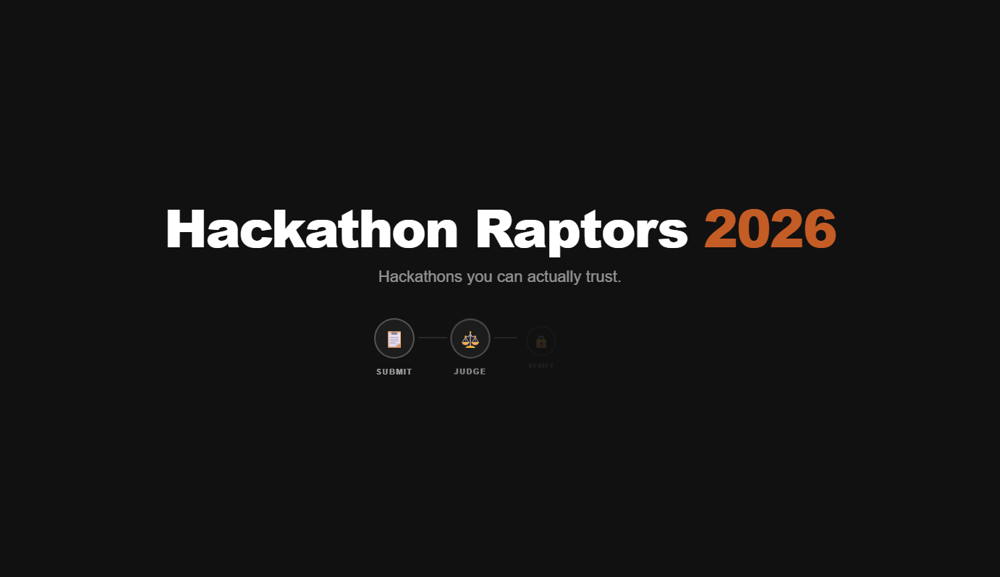
</p>

---

### 2. Public Submissions Gallery with Interactive Grid
> **Route: `/projects`**  
> Public discovery portal with real-time mouse-tracking subtle grid background, project metadata cards, track filter pills (`Accessibility`, `Climate`, `Data and analytics`, `Developer tools`, `Education`, `Health`, `Open hardware`, `Security`), search indexing, and project lifecycle badges (`SUBMISSIONS CLOSED`).

<p align="center">
  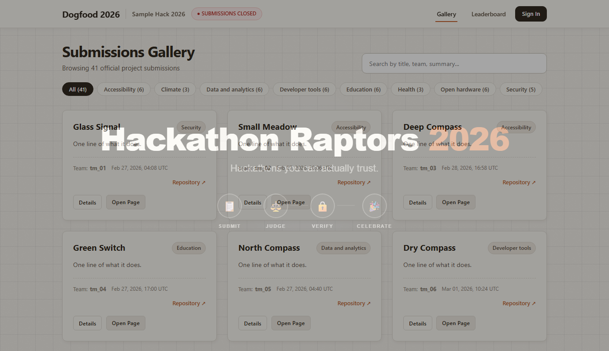
</p>

---

### 3. Organizer Operations Control Room & Lifecycle Windows
> **Route: `/dashboard` (Role: Organizer)**  
> Comprehensive administration workspace exposing configurable event lifecycle windows (Registration, Submissions, Judging), track/prize configurations, judge roster administration, and one-click auditable CSV exports.

<p align="center">
  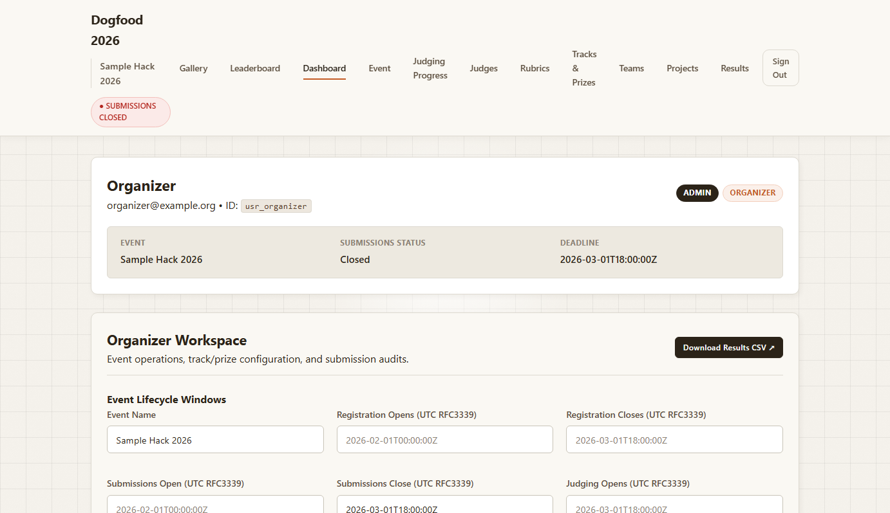
</p>

---

### 4. Real-Time Judging Velocity & Project Coverage Analytics
> **Route: `/dashboard#judging-progress` (Role: Organizer)**  
> Operational telemetry tracking review velocity across 123 assignments and 30 judges: completed reviews (95.9%), unstarted allocations, reviewer distribution graphs, and track completion progress bars without database table locks.

<p align="center">
  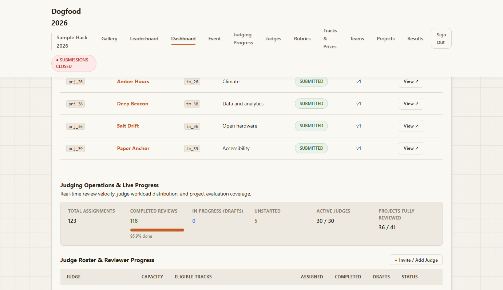
</p>

---

### 5. Judge Evaluation Workspace & Assignment Ledger
> **Route: `/dashboard` (Role: Judge — Tomas Varga)**  
> Role-isolated judge cockpit displaying assigned submissions, project abstracts, evaluation statuses (`NOT STARTED`, `DRAFT`, `SUBMITTED`), and explicit notice of the peer isolation security policy.

<p align="center">
  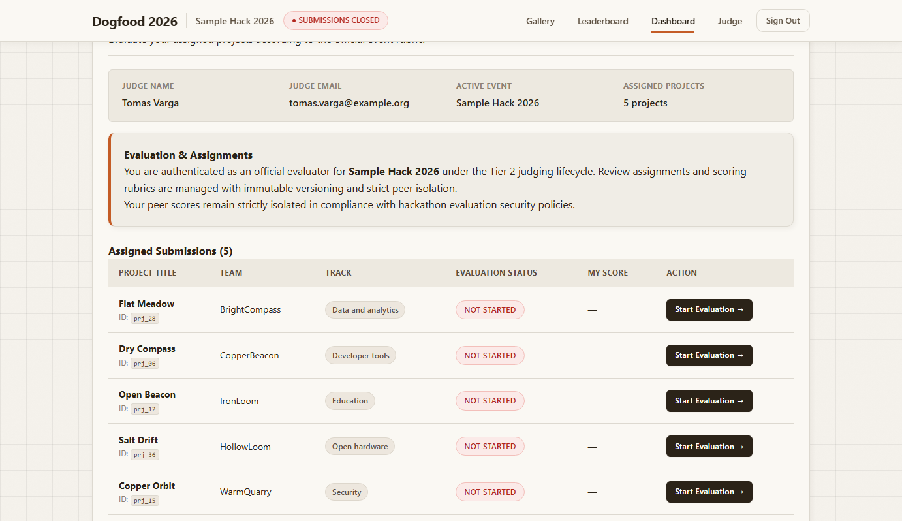
</p>

---

### 6. Criteria-Weighted Scoring Ballot & Immutability Lock
> **Route: `/evaluations/{assignment_id}` (Role: Judge)**  
> Evaluation interface displaying project details, repository links, and the active versioned rubric with criteria weights and SHA-256 configuration hash. Allows saving intermediate drafts and committing permanent ballots.

<p align="center">
  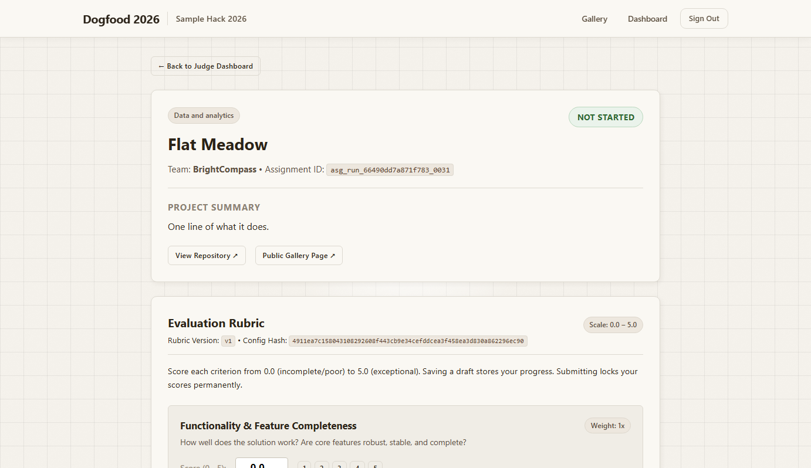
</p>

---

### 7. Public Official Leaderboard & Winners Podium
> **Route: `/results`**  
> Published competition leaderboard featuring the top-3 winners podium, statistical normalization audit headers, active algorithm key (`z_score_standardization v1.0.0`), canonical SHA-256 input digest, final normalized scores, raw averages, and direct links to cryptographic receipts.

<p align="center">
  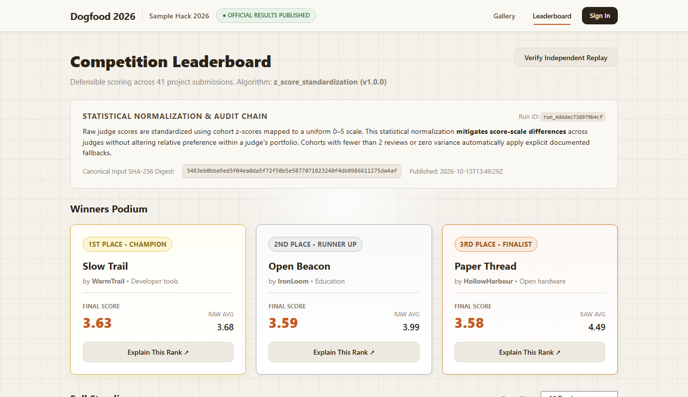
</p>

---

### 8. Mathematical Audit Receipt ("Explain This Rank")
> **Route: `/results/{run_id}/projects/{project_id}`**  
> Full transparent mathematical receipt proving the derivation of a project's standing: review quorum counts, per-judge raw scores, judge cohort sample mean $\mu_j$, Bessel standard deviation $\sigma_j$, standardized z-scores, linear rescaling, fallback codes, and tie-breaking comparator logs.

<p align="center">
  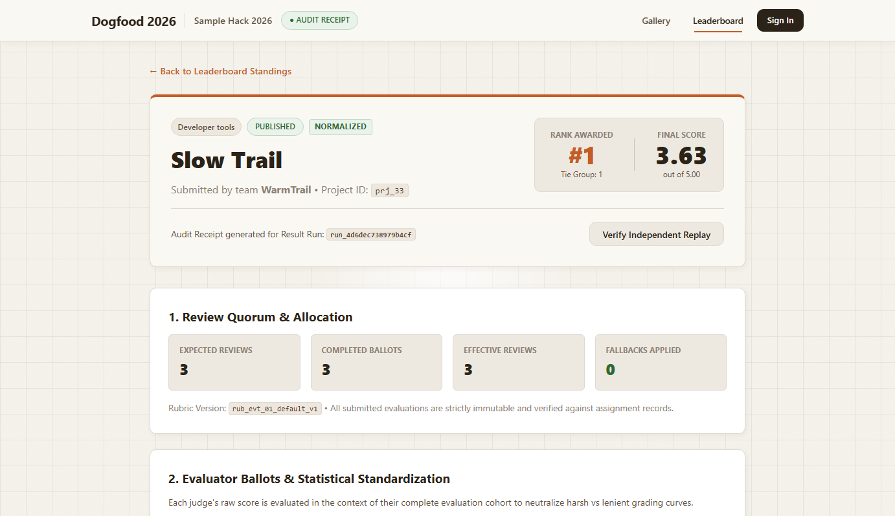
</p>

---

### 9. Project Submission View with Community Voting & Comments
> **Route: `/projects/{project_id}`**  
> Detailed submission presentation showcasing team attribution, repository links, track categories, duplicate-protected community voting, hidden vote tally enforcement during voting windows, and threaded community discussion comments.

<p align="center">
  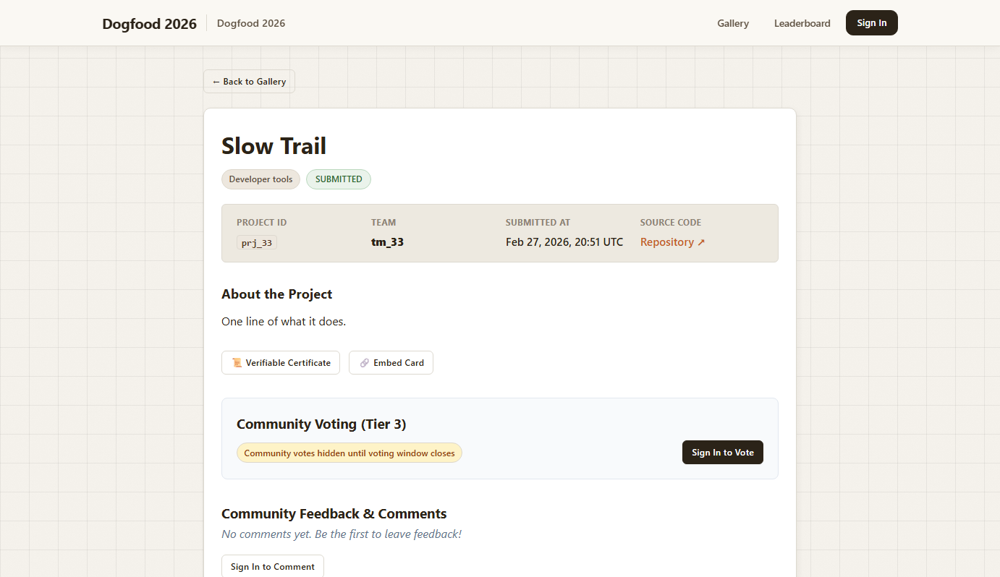
</p>

---

### 10. Cryptographically Sealed Certificate of Completion
> **Route: `/projects/{project_id}/certificate`**  
> Verifiable completion credential displaying official event validation, project identity, team attribution, and a verifiable SHA-256 cryptographic integrity seal backed by `/api/v1/projects/{id}/certificate/verify`.

<p align="center">
  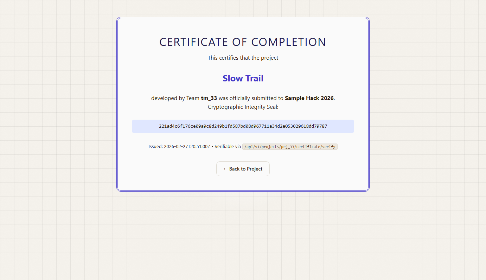
</p>

---

### 11. Zero-Trust Persona Switcher & Authentication
> **Route: `/login`**  
> Seamless demo persona switcher providing immediate single-click role switching between Organizer, Judges, and Participants, alongside email-based magic authentication.

<p align="center">
  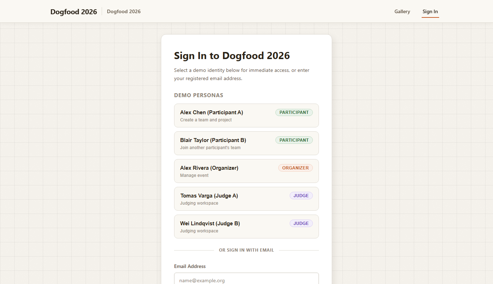
</p>

---

## 🧮 Statistical & Normalization Mathematics

Naive arithmetic averaging introduces severe bias when judges employ disparate grading scales. Dogfood mitigates this distortion using sample-standardized z-scores rescaled onto a standard $[0.0, 5.0]$ evaluation domain.

### 1. Judge Cohort Distribution
For each judge $j$, the engine collects their cohort of finalized raw weighted scores $\mathcal{B}_j = \{x_{j,1}, x_{j,2}, \dots, x_{j,N}\}$. It computes the sample mean $\mu_j$ and, applying **Bessel's correction $(N-1)$** for unbiased variance estimation, the sample standard deviation $\sigma_j$:

$$\mu_j = \frac{1}{N} \sum_{k=1}^N x_{j,k}, \qquad \sigma_j = \sqrt{\frac{1}{N-1} \sum_{k=1}^N (x_{j,k} - \mu_j)^2}$$

### 2. Standardized Z-Score & Linear Rescaling
Each ballot's standardized rating is computed as:

$$z_{j,p} = \frac{x_{j,p} - \mu_j}{\sigma_j}$$

Because raw z-scores typically fall in the range $[-3.0, +3.0]$, the score is linearly mapped back to the standard $[0.0, 5.0]$ hackathon scale centered at $2.5$ with scale factor $0.8$:

$$S_{\text{norm}}(j,p) = \max\left(0.0, \min\left(5.0, 2.5 + 0.8 \cdot z_{j,p}\right)\right)$$

### 3. Edge-Case Fallback Matrix
Real judging data frequently encounters degenerate edge cases where standard statistical formulas are undefined. Dogfood handles these gracefully with explicit, auditable fallback codes:

| Edge Condition | Mathematical Dilemma | Fallback Code | Fallback Policy |
|---|---|---|---|
| **Constant Judge** ($\sigma_j < 10^{-9}$) | Division by zero ($\frac{x - \mu}{0} \to \text{NaN}$) | `ZERO_VARIANCE` | Fallback to raw score; records explicit explanation. |
| **Small Sample** ($N_j < 2$) | Undefined denominator ($N-1 = 0$) | `LOW_N` | Fallback to raw score; preserves reviewer input. |
| **Standard Review** ($N_j \ge 2, \sigma_j > 0$) | Well-defined sample distribution | `NONE` / `STANDARD` | Full z-score standardization applied. |

### 4. Deterministic 4-Tier Lexicographical Tie-Breaking
When projects tie on normalized score, ranking is resolved through a strict, deterministic total order comparator that never relies on database insertion order or memory layout:

$$\text{Final Score (DESC)} \longrightarrow \text{Raw Score Average (DESC)} \longrightarrow \text{Completed Reviews (DESC)} \longrightarrow \text{Project ID (ASC)}$$

---

## 🛠 Tech Stack

### Core Platform & Backend
| Technology | Version / Spec | Purpose |
|---|---|---|
| **Go** | 1.22+ | Strongly typed, garbage-collected compiled runtime with zero external runtime dependencies |
| **Go Standard Library** | `net/http`, `html/template`, `crypto/sha256` | HTTP multiplexer, server-rendered views, cryptographic hashing |
| **ModernC SQLite** | Pure Go SQLite driver | In-process embedded SQL storage with zero CGO compilation requirements |

### Storage & Persistence
| Component | Configuration | Architecture Role |
|---|---|---|
| **Journaling Mode** | `PRAGMA journal_mode = WAL;` | High-concurrency Write-Ahead Logging preventing writer-reader contention |
| **Integrity Enforcement** | `PRAGMA foreign_keys = ON;` | Strict relational foreign key cascades across 18 schema tables |
| **Busy Timeout** | `PRAGMA busy_timeout = 5000;` | Automatic retry handler mitigating database busy locks under peak evaluation bursts |

### Frontend & Styling
| Component | Framework | Purpose |
|---|---|---|
| **Styling** | Vanilla CSS (`/static/app.css`) | Custom design system with light/dark adaptive variables, card grids, and data tables |
| **Typography** | Native System Font Stack | `-apple-system, BlinkMacSystemFont, 'Segoe UI', Roboto, Helvetica, Arial` (Zero Google Fonts / CDNs) |
| **Interactivity** | Vanilla JS (Embedded) | Dynamic mouse-tracking background grid, quick filter pills, and non-blocking dialogs |

---

## 🚀 Quick Start

### 1. Run Natively with Go
```bash
# Requires Go 1.22+
go run ./cmd/dogfood --port 8080 --db dogfood.db

# Open portal in your browser
http://localhost:8080
```
*Migrations run automatically on first boot, and the canonical dataset from `official/fixtures.json` is safely imported.*

### 2. Run with Docker
```bash
# Build and run the minimal container
docker compose up --build

# Access portal
http://localhost:8080
```

### 3. Run in Offline / Air-Gapped Environments
If operating on a restricted machine without build toolchains or Docker registries:
```bash
# 1. Load the pre-packaged offline image archive
docker load < dist/dogfood-image-linux-amd64.tar.gz

# 2. Run with preloaded compose configuration (pull_policy: never)
docker compose -f compose.preloaded.yaml up -d
```

### 4. Run Verification & Acceptance Suites
```bash
# 1. Run all unit and integration tests across 8 packages
go test -count=1 ./...

# 2. Run official acceptance test harness
python official/run.py .dogfood.toml
# Result: claimed T1 T2, verified T1 T2 (7/7 PASS)
```

---

## 🔒 Cryptographic Replay Verification Engine

Dogfood enables any participant, judge, or third-party auditor to independently verify published results:

```bash
# Verify entire published result run
go run ./cmd/dogfood replay <run_id>

# Verify a specific project within a run
go run ./cmd/dogfood replay <run_id> <project_id>
```

### Replay Execution Output
```text
=== DOGFOOD 2026 AUDITABLE REPLAY ENGINE ===
Verifying Result Run: run_4d6dec738979b4cf
Canonical Input Digest Expected: 5483eb0bba9ed5f04ea0da5f72f50b5e5877071823240f4db0986611275da4af
Canonical Input Digest Computed: 5483eb0bba9ed5f04ea0da5f72f50b5e5877071823240f4db0986611275da4af
Digest Integrity: PASS (Cryptographically Identical)
Projects Evaluated: 41
================================================
FINAL VERDICT: PASS (100% Mathematical Equality Verified)
```

The replay engine parses the immutable SHA-256 input manifest, completely bypasses the stored results, independently recomputes all normalization and tie-breaking arithmetic, and verifies exact bit-for-bit parity.

---

## 👥 Pre-Seeded Demo Personas

Fast authentication is built directly into the `/login` portal:

| Persona | Role | Email | Pre-Configured Token |
|---|---|---|---|
| **Alex Rivera** | Organizer / Admin | `organizer@dogfood.internal` | `org_7f2a` |
| **Tomas Varga** | Official Judge (A) | `tomas.varga@dogfood.internal` | `jdg_a_91bc` |
| **Wei Lindqvist** | Official Judge (B) | `wei.lindqvist@dogfood.internal` | `jdg_b_44de` |
| **Alex Chen** | Participant (Team Alpha) | `alex@dogfood.internal` | `prt_2e88` |
| **Blair Taylor** | Participant (Team Beta) | `blair@dogfood.internal` | *(session login)* |

---

## 🔌 Programmatic REST API

The platform exposes an API-first interface (`/api/v1`) with full OpenAPI 3.0 specifications:

| Method | Route | Description | Auth Required |
|---|---|---|---|
| `GET` | `/api/v1/projects` | List public projects with optional `?track=` filter | Public |
| `GET` | `/api/v1/teams` | List registered teams and roster counts | Public |
| `GET` | `/api/v1/tracks` | List event tracks and project counts | Public |
| `GET` | `/api/v1/prizes` | List competition tracks and configured prizes | Public |
| `GET` | `/api/v1/results` | Active published results run and ranked standings | Public |
| `GET` | `/api/v1/results/{run_id}/projects/{id}` | Detailed project mathematical derivation payload | Public |
| `GET` | `/api/v1/results/{run_id}/replay` | Full result run replay verification report | Public |
| `GET` | `/api/v1/results/{run_id}/replay/{id}` | Single project replay verification report | Public |
| `POST` | `/api/v1/projects/{id}/vote` | Cast duplicate-protected community vote | Participant |
| `GET` | `/api/v1/projects/{id}/certificate/verify` | Verify project completion certificate digest | Public |
| `GET` | `/api/v1/organizer/progress` | Real-time review velocity and project coverage metrics | Organizer |
| `POST` | `/api/v1/organizer/judges` | Add judge, set capacity and track eligibility graph | Organizer |
| `POST` | `/api/v1/organizer/rubrics` | Author and publish a new immutable rubric version | Organizer |
| `POST` | `/api/v1/organizer/assignments/run` | Trigger deterministic bipartite reviewer allocation | Organizer |
| `POST` | `/api/v1/organizer/results/recompute-publish` | Recompute normalized standings and publish run | Organizer |
| `GET` | `/api/v1/export.csv` | RFC 4180 standings CSV with F21 formula injection shield | Public / Org |
| `GET` | `/api/v1/export/evaluations.csv` | Itemized per-judge ballot audit export | Organizer |
| `GET` | `/api/v1/export.json` | Complete event data bulk export | Organizer |

---

## 📁 Repository Structure

```
├── cmd/
│   └── dogfood/
│       └── main.go                  # Application entrypoint (server, replay, healthcheck)
├── internal/
│   ├── assignment/
│   │   ├── engine.go                # Bipartite matching & deterministic reviewer allocator
│   │   └── service.go               # Allocation lifecycle & capacity graph management
│   ├── auth/
│   │   ├── auth.go                  # Session token extraction, SHA-256 hashing & RBAC
│   │   └── auth_test.go             # Session security & token validation tests
│   ├── db/
│   │   └── db.go                    # SQLite database opener with WAL pragmas & busy timeouts
│   ├── httpapp/
│   │   ├── server.go                # Core HTTP multiplexer, route handlers, middleware
│   │   ├── adversarial_test.go      # Failure modes inventory suite (F02–F21)
│   │   ├── organizer_judging_test.go# Real-time review velocity & progress tests
│   │   ├── csv_export.go            # RFC 4180 exporter with formula injection neutralization
│   │   ├── t3_t4.go                 # Community voting, comments, certificate verification
│   │   └── human_acceptance_test.go # End-to-end user journey acceptance tests
│   ├── judging/
│   │   ├── service.go               # Versioned rubric creation & immutable ballot submission
│   │   └── service_test.go          # Ballot conflict (409) & rubric validation tests
│   ├── migrations/
│   │   └── migrations.go            # Embedded schema migration engine (18 SQL tables)
│   ├── results/
│   │   ├── engine.go                # Z-score standardization, Bessel std dev, tie-breaking
│   │   └── service.go               # Manifest construction, SHA-256 digest, audit receipts
│   └── seed/
│       ├── seed.go                  # Canonical JSON fixture loader with hash verification
│       └── seed_test.go             # Idempotency and provenance integrity tests
├── official/
│   ├── fixtures.json                # Canonical official hackathon fixture dataset
│   └── run.py                       # Official acceptance test evaluation harness
├── web/
│   ├── static/
│   │   └── app.css                  # Embedded stylesheet with dark/light themes & system fonts
│   ├── templates/
│   │   ├── index.html               # Public project gallery & animated boot sequence
│   │   ├── login.html               # Zero-trust persona switcher & authentication
│   │   ├── dashboard.html           # Role-adaptive workspace (Organizer, Judge, Participant)
│   │   ├── evaluation.html          # Criteria-weighted rubric scoring ballot
│   │   ├── results.html             # Public official leaderboard & winners podium
│   │   ├── explain_rank.html        # Transparent "Explain This Rank" mathematical audit receipt
│   │   ├── project_detail.html      # Project submission view with voting & comments
│   │   └── team_join.html           # Team invitation & membership join interface
│   └── web.go                       # Go embed.FS filesystem exports
├── docs/
│   └── images/                      # Captured high-resolution UI screen assets
├── .dogfood.toml                    # Official acceptance test configuration manifest
├── ARCHITECTURE.md                  # Comprehensive architectural specification
├── DATA-MODEL.md                    # Complete 18-table schema dictionary & indexes
├── DECISIONS.md                     # Engineering decision ledger across 17 checkpoints
├── DEMO-SCRIPT.md                   # 5-minute video presentation demonstration script
├── JUDGING.md                       # Rubric weighting, allocation & normalization reference
├── NORMALIZATION-PROOF.md           # Formal mathematical proof of scale normalization
├── THREAT-MODEL.md                  # Security threat model & authorization invariants
├── WRITEUP.md                       # Engineering retrospective on hackathon judging
├── compose.preloaded.yaml           # Offline air-gapped Docker compose configuration
├── docker-compose.yml               # Production multi-stage Docker compose configuration
├── Dockerfile                       # Multi-stage scratch Docker container build
├── openapi.yaml                     # Complete OpenAPI 3.0 programmatic API specification
└── README.md                        # Authoritative project documentation
```

---

## 🛡️ Threat Model & Security Invariants

Dogfood treats hackathon evaluation as a safety-critical transaction environment:

1. **Peer Judge Isolation**: In `internal/httpapp/server.go`, `handleJudgeScores` checks caller session identity. Judge B attempting to read `GET /api/judge/scores?judge=judge_a` receives `403 Forbidden`. Attempting to submit a ballot for Judge A's assignment is rejected with `403 Forbidden`.
2. **Participant Blocking**: Participants attempting to query judge evaluations, access draft results, or trigger organizer operations are blocked with `403 Forbidden`.
3. **Immutable Ballots & Rubrics**: Ballots and rubrics are append-only. Once submitted, attempting to overwrite a ballot returns `409 Conflict`. When rubric weights change, a new version is created (`v(N+1)`); previously committed ballots remain permanently sealed to their original version.
4. **Spreadsheet Formula Injection Defense (F21)**: If a project title or field begins with formula execution characters (`=`, `+`, `-`, `@`, `\t`, `\r`), the CSV exporter automatically prepends an apostrophe `'`, preventing remote code execution when opened in Excel or Google Sheets.
5. **Zero External Surface**: The production image is built `FROM scratch`, containing only the precompiled Go binary and fixture definitions. No shell, package manager, or network utility exists in the container.

---

## 👨‍💻 Authors & Team

Developed by **Team Hackathon Raptors**:

- **Mumuksh (Moksh) Jain** — [@Mumuksh-Jain](https://github.com/Mumuksh-Jain)

**Repository:** [https://github.com/Mumuksh-Jain/dogfood](https://github.com/Mumuksh-Jain/dogfood)

---

⭐ If you found this defensible judging engine and offline-first hackathon platform insightful, consider starring the repository!